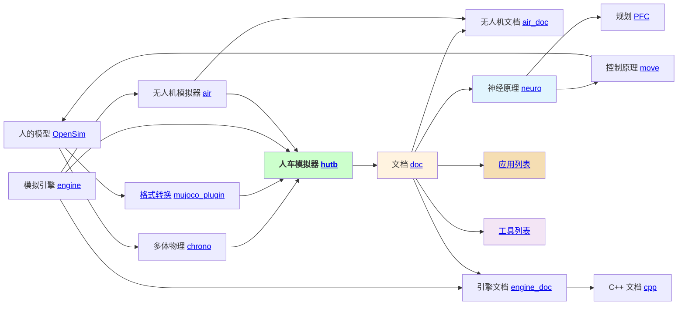
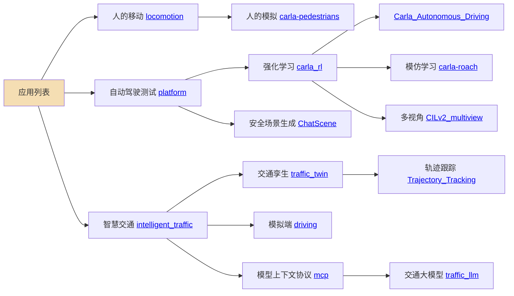
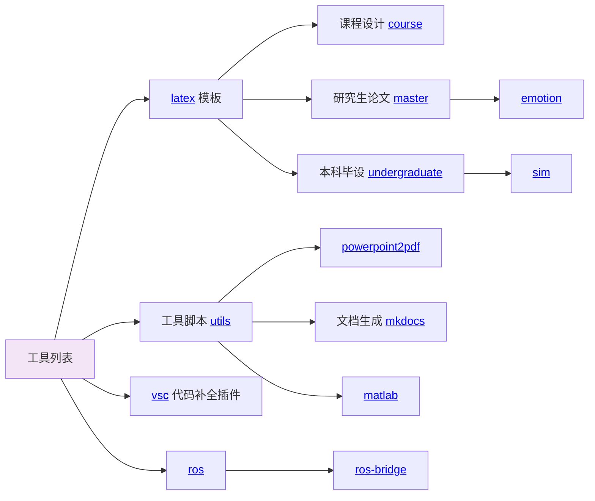

# OpenHUTB

OpenHUTB 简单来说是面向人机共生与智能载具研究、教学和开发，提供影视级物理模拟器、开放数字资产，以及感知、规划、控制和场景生成工具的开源仿真社区。该社区具体提供一个包含人车代理（学术研究）、模拟器（技术开发包括数据驱动、机理仿真、界面渲染）、现实场景（艺术增强）的 [模拟器](https://openhutb.github.io) ，代理包括[感知](https://openhutb.github.io/doc/algorithms/perception/) （连接）、[规划](https://openhutb.github.io/doc/algorithms/planning/) （符号）、[控制](https://openhutb.github.io/doc/algorithms/control/) （行为）；模拟器包括 Python 与 C++ 的接口（正向创建、反向构建）、LibCarla、虚幻引擎插件；现实场景包括 [静态场景孪生](https://openhutb.github.io/doc/adv_digital_twin/) 、[动态场景孪生](https://github.com/OpenHUTB/traffic_twin/) 。

## 贡献想法与计划

社区文档连接开发环境、模型制作和项目协作。入门说明除了告诉读者点哪里、运行什么命令，还需要交代适用条件，以及完成后该检查什么。维护重点放在容易让操作中断或交付不完整的环节，保留已有示例，再补上缺失的步骤。

本轮围绕以下五个问题开展修改：

| 方向 | 具体改进 | 讨论与修改 |
| --- | --- | --- |
| Python 环境交接 | 保存版本和依赖清单，在新环境安装并检查，避免直接复制整个虚拟环境 | [问题 #453](https://github.com/OpenHUTB/.github/issues/453) · [修改 #458](https://github.com/OpenHUTB/.github/pull/458) |
| Blender 素材交付 | 检查缺失贴图，说明资源打包、相对路径和导出后的材质检查 | [问题 #454](https://github.com/OpenHUTB/.github/issues/454) · [修改 #459](https://github.com/OpenHUTB/.github/pull/459) |
| 虚拟机磁盘扩容 | 根分区被占用时从试用环境离线调整，再回到原系统核对容量 | [问题 #455](https://github.com/OpenHUTB/.github/issues/455) · [修改 #460](https://github.com/OpenHUTB/.github/pull/460) |
| Git 提交身份 | 区分作者信息与登录认证，补充仓库级配置和邮箱归属检查 | [问题 #456](https://github.com/OpenHUTB/.github/issues/456) · [修改 #461](https://github.com/OpenHUTB/.github/pull/461) |
| 提交统计工具 | 屏蔽名单格式有误时停止统计，保留原有结果，并覆盖异常输入测试 | [问题 #457](https://github.com/OpenHUTB/.github/issues/457) · [修改 #462](https://github.com/OpenHUTB/.github/pull/462) |

后续先跟进这五项修改的讨论，在各自分支处理反馈，核对最终差异和构建结果。文档中的命令、界面名称与适用范围一起检查；涉及分区或文件写入时，明确确认步骤和完成后的检查办法。脚本修改继续保留有效输入、异常输入和已有输出保护的测试，避免只验证正常情况。

参与审核时同时查看说明和完整差异，重点检查命令能否前后衔接、链接目标是否正确、示例与正文是否一致；发现问题时给出具体位置和可操作的建议。

## 社区入口

以下为新手快速上手栏目：

[🚀 快速开始](https://github.com/OpenHUTB/hutb#使用示例) · [📖 在线文档](https://openhutb.github.io/) · [🧪 运行示例](https://github.com/OpenHUTB/doc/tree/master/src/examples) · [🤝 参与贡献](https://github.com/OpenHUTB/.github/blob/master/CONTRIBUTING.md) · [💬 提问与讨论](https://github.com/orgs/OpenHUTB/discussions)
- [💡 贡献小贴士](contribute-tips.md)

你可以用 OpenHUTB 做什么？
- **研究与教学**：学习感知、规划、控制和具身智能算法。
- **仿真与验证**：在可重复的场景中开发、训练和验证算法。
- **场景与内容开发**：使用开放的城镇、建筑、车辆、行人和道具资产创建仿真环境。

核心入口

- 🟡 **[hutb 人车模拟器](https://github.com/OpenHUTB/hutb)** — 提供下载工具、Python API 和交通生成示例，目前持续开发中。
- 📚 **[doc 人车文档](https://github.com/OpenHUTB/doc)** — 人车模拟器配套安装说明、API与教程文档。

### 研究与实验项目

- 🧪 **[traffic_twin 人车孪生](https://github.com/OpenHUTB/traffic_twin)** — 交通数字孪生相关研究和示例，使用前请查看仓库说明。
- 🧠 **[neuro 神经原理](https://github.com/OpenHUTB/neuro)** — 用于感知与神经网络算法的相关研究与实验。
- 🧭 **[PFC 规划](https://github.com/OpenHUTB/PFC)** — 智能规划与决策相关研究。
- 🎮 **[move 控制原理](https://github.com/OpenHUTB/move)** — 运动控制与生物力学相关。

人车模拟器的技术架构如下图所示：

<!--所有项目关系的思维导图。-->
<!-- 使用markmap进行编辑并生成svg：https://markmap.js.org/repl -->
<!-- 在profile/markmap.md中去保存图的数据 -->
<!-- svg图片预览：https://raw.githack.com/ -->

## 社区项目之间的关系

### 应用列表

### 工具列表

